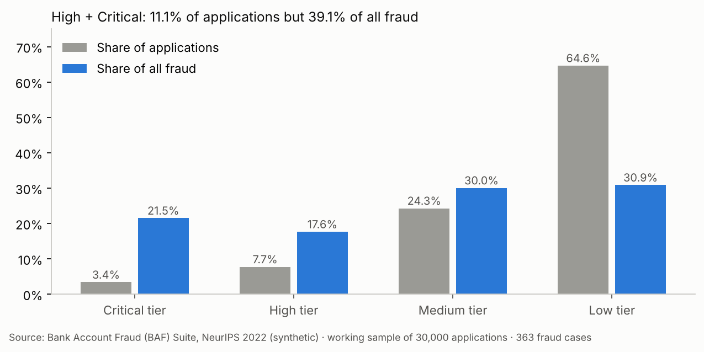
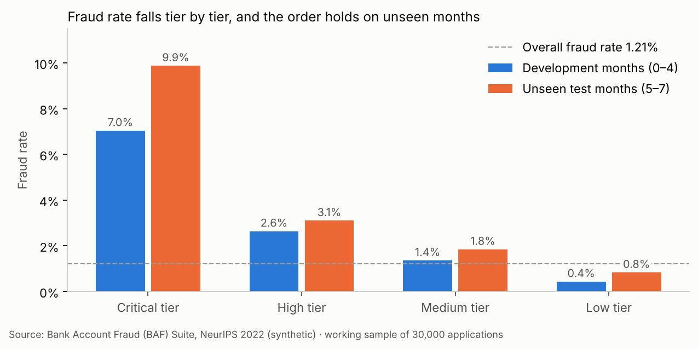
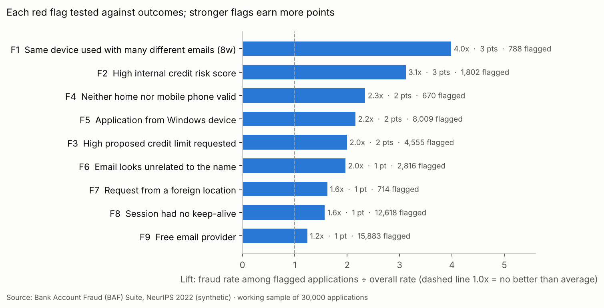
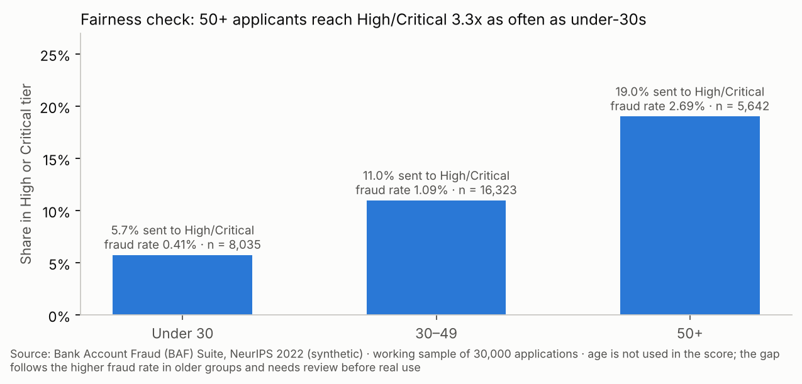

# Application Risk Profiling & Review Prioritisation (KYC-style) — Excel

A rule-based risk scoring model that sorts 30,000 bank account applications into **Low / Medium / High / Critical** tiers so a review team looks at the riskiest cases first. Built in Excel with every threshold in one editable sheet.

> **Scope, stated honestly:** the dataset label is **account-opening fraud**, not money laundering or a KYC outcome. I use it to practise the *risk-rating and review-prioritisation* part of KYC/CDD on a large, realistic data set. The data is **synthetic**.

## Dataset
- Bank Account Fraud (BAF) Suite, NeurIPS 2022, `Base.csv` — 1,000,000 synthetic account applications, 32 columns, ~1.1% fraud. Downloaded from Kaggle ("Bank Account Fraud Dataset Suite (NeurIPS 2022)").
- Working sample: **30,000 applications** (`BAF_Sample_30k.csv`), stratified by month, random seed 42: 363 fraud cases (1.21%; the full file is about 1.1%).
- `-1` is the missing-value code in several columns (treated as missing, not as a real value).

## Method
1. **Data quality & CIP-style checks** — missing codes, range check, age-band eligibility, contactability, duplicate IDs.
2. **Nine risk flags**, each a plain-English rule with a threshold and points, all stored in `Ref_Rules`.
3. **Rule evaluation** — for every flag: how many applications it flags, how many were fraud, precision, and *lift* over the base rate. Flags that did not separate fraud were rejected; for example, a short address history (under 12 months) had a fraud rate below the base rate (lift 0.3x), so it was dropped.
4. **Score → tier** — Low 0–2, Medium 3–4, High 5–6, Critical 7+; each tier maps to a review action.
5. **Time-based validation** — rules chosen on months 0–4, checked on months 5–7.
6. **Fairness check** — age, income and employment are sensitive attributes (age is legally protected in many countries), so they are **not** in the score; the `Fairness` sheet checks whether the score still treats age groups very differently.

## Results (sample of 30,000)
| Tier | Applications | Share | Fraud cases | Fraud rate |
|---|---|---|---|---|
| Critical | 1,010 | 3.4% | 78 | 7.72% |
| High | 2,317 | 7.7% | 64 | 2.76% |
| Medium | 7,282 | 24.3% | 109 | 1.50% |
| Low | 19,391 | 64.6% | 112 | 0.58% |

- Critical + High = **11.1% of applications but 39.1% of all fraud**, a fraud rate of 4.3% vs the 1.21% base rate.
- Holds on unseen test months: Critical 9.9% → High 3.1% → Medium 1.8% → Low 0.8% (same order as development).
- Most useful single flags (lift): same device with 2+ emails (4.0x), high credit risk score (3.1x), both phones invalid (2.3x).

| Fraud rate by tier, development vs unseen months | Lift of each red flag |
| --- | --- |
|  |  |

## Limitations
- Rule-based scoring misses fraud: **112 of 363 fraud cases (31%) sit in the Low tier.**
- Fraud rate in the Critical tier is 7.7%, so most Critical cases are still genuine customers — the score prioritises review, it does not decide.
- Age is not in the score, but the 50+ group is sent to High/Critical **3.3x** as often as under-30s, because fraud is genuinely more common in that group in this data. This needs a human explanation before real use.
- Synthetic data, application fraud label, one bank's pattern — results will not transfer unchanged.

## Excel skills used
Structured parameter sheet with named ranges, `IF`/nested tiering, `SUMPRODUCT`, `COUNTIFS`, `SUMIFS`, `INDEX`/`MATCH`, data validation on inputs, conditional formatting, charts, built-in reconciliation checks (tier counts = row count, fraud in tiers = total fraud).

## Files
| File | What it is |
|---|---|
| `KYC_Risk_Profiling_Solved.xlsx` | Finished workbook with live formulas |
| `BAF_Sample_30k.csv` | The 30,000-row working sample |
| `charts.py` | Re-scores the sample in Python using the thresholds in `Ref_Rules`, checks the tier counts match the workbook, and draws the charts |
| `charts/` | Report charts |

## How to use
Open `Ref_Rules`, change any yellow cell (a threshold, a point value, a tier cut-off), and every flag, score, tier, summary and chart recalculates.

To redraw the charts: `pip install -r requirements.txt`, then `python charts.py`.

---
Author: **Salil Gokhale** · [LinkedIn](https://www.linkedin.com/in/salil-gokhale-analytics)
